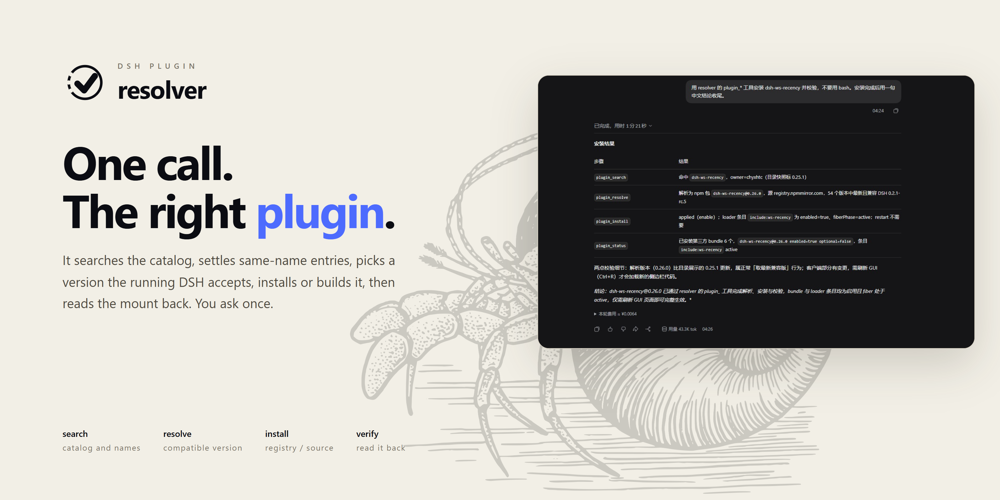

<p align="center">
  
</p>

<p align="center">
  <a href="README.md">简体中文</a> · <b>English</b>
</p>

<p align="center">
  <a href="https://www.npmjs.com/package/dsh-plugin-resolver"></a>
  <a href="https://github.com/sakikoTGW/dsh-plugin-resolver/actions/workflows/test.yml"></a>
  
  <a href="LICENSE"></a>
</p>

<p align="center"><sub>45 checks · dsh.so L5 run-verified · dshbase Verified · DSH ≥0.2.0-rc.2 &lt;0.3.0 · Node ≥20</sub></p>

I built this because handing plugin installs to an agent kept going wrong. The community catalog is 8 MB and takes about 90 seconds to pull from GitHub Pages. There are 406 groups of same-name plugins; `dsh-browser` alone has nine owners. The `latest` tag doesn't always accept the running core, and when it doesn't, the host quietly disables the plugin on boot. GitHub-only repos often ship no build output, so `main` points at a file that doesn't exist and the plugin installs but never loads.

Those checks were being redone every time. I put them into the plugin, so an install is one tool call.

If you are the agent, start with [`llms.txt`](llms.txt). The full contract is in [`agent.json`](agent.json).

## Here it is running

<p align="center">
  
</p>

<p align="center"><sub>A real DSH session installing <code>dsh-ws-recency@0.26.0</code>. It searches, resolves the version, and reads the mount back.</sub></p>

Doing this by hand took 45 tool calls and over 20 minutes. The plugin does it in 6 calls and about 3 minutes, with no retries. The measurements and the ablation are in [BENCHMARK](BENCHMARK.md) and [ABLATION](ABLATION.md).

## Install

| Plugin market | npm |
|---|---|
|  |  |

I usually just tell the agent:

```text
Install dsh-plugin-resolver, then use it to install dsh-browser.
```

<details>
<summary>Typing it yourself</summary>

Market index source:

```text
https://sakikoTGW.github.io/dsh-plugin-resolver/market/index.json
```

```sh
dsh plugin --profile <profile> add dsh-plugin-resolver
```

GitHub source or tarball:

```sh
dsh plugin --profile <profile> add github:sakikoTGW/dsh-plugin-resolver#<commit>
```

</details>

## How it works

| Stage | Tool | What comes back |
|---|---|---|
| Search | `plugin_search` | Catalog hits, owner, stars, npm name, ambiguity |
| Resolve | `plugin_resolve` | Package, install spec, registry, source-build need |
| Install | `plugin_install` | Changes to profile, lockfile, plugin-sources |
| Verify | `plugin_status` | Bundle, loader entry, fiberPhase |
| Report | return value | Applied state, restart decision, next step |

`plugin_install` writes the environment. The other three are read-only.

## Ecosystem

- [dsh-plugins](https://github.com/sakikoTGW/dsh-plugins): the plugin set and catalog
- [dsh.so](https://www.dsh.so/zh/artifact/dsh-plugin-resolver/): L5 run-verified
- [dshbase](https://dshbase.com/plugins/dsh-plugin-resolver/): Verified
- Market index source: `https://sakikoTGW.github.io/dsh-plugin-resolver/market/index.json`

## What it covers

| Capability | npm | GitHub-only | Explicit spec |
|---|---|---|---|
| Same-name disambiguation | ✓ | ✓ | ✓ |
| Compatible version | ✓ | ✓ | Yours to give |
| Source build | — | ✓ | Per spec |
| Post-install check | ✓ | ✓ | ✓ |
| Restart decision | ✓ | ✓ | ✓ |

## Features

- It doesn't pick between same-name plugins for you. Search returns every candidate with owner, stars and npm name, and you pass `owner=` or a full spec.
- Versions are solved against `engines.dsh` and same-namespace peers. What comes back is an install spec you can review first.
- For GitHub-only packages with no build output, it runs `pnpm install` and `pnpm run build`, then installs through `link:`.
- After install it reads back the bundle, loader entry and fiberPhase. The manager's actual result decides whether a restart is needed.

## Validation

```sh
npm test   # 45 passing: 35 logic + 10 harness
```

The machine-readable entry lives in [`agent.json`](agent.json) under `validation`. CI is in [test.yml](https://github.com/sakikoTGW/dsh-plugin-resolver/actions/workflows/test.yml).

## Contract for agents

```json
{
  "tools": ["plugin_search", "plugin_resolve", "plugin_install", "plugin_status"],
  "versionRule": "engines.dsh first; otherwise same-namespace @deepseek-ai/dsh peers",
  "ambiguity": "owner= or a full spec",
  "writes": ["profile", "lockfile", "plugin-sources"],
  "restart": "plugin manager result"
}
```

The full contract is in [`agent.json`](agent.json), and the agent index is [`llms.txt`](llms.txt). Issues go to [GitHub](https://github.com/sakikoTGW/dsh-plugin-resolver/issues); more plugins are in [dsh-plugins](https://github.com/sakikoTGW/dsh-plugins).

## Reference

Web version: [sakikoTGW.github.io/dsh-plugin-resolver/docs/](https://sakikoTGW.github.io/dsh-plugin-resolver/docs/)

| Topic | Where |
|---|---|
| Four tools | [docs/TOOLS.md](docs/TOOLS.md) |
| Version selection | [docs/VERSION-SELECTION.md](docs/VERSION-SELECTION.md) |
| Install paths and restarts | [docs/INSTALL-PATHS.md](docs/INSTALL-PATHS.md) |
| Architecture | [docs/ARCHITECTURE.md](docs/ARCHITECTURE.md) |
| Evidence | [docs/EVIDENCE.md](docs/EVIDENCE.md) · [BENCHMARK](BENCHMARK.md) · [ABLATION](ABLATION.md) |
| Tests and CI | [docs/TESTING.md](docs/TESTING.md) |
| Known limits | [docs/LIMITATIONS.md](docs/LIMITATIONS.md) |
| Feedback and security | [docs/SECURITY.md](docs/SECURITY.md) · [Issues](https://github.com/sakikoTGW/dsh-plugin-resolver/issues) |
| License | [LICENSE](LICENSE) |

<p align="center"><sub>MIT · <a href="https://github.com/deepseek-ai/deepseek-harness">DeepSeek Harness</a> · <a href="#">Back to top</a></sub></p>
