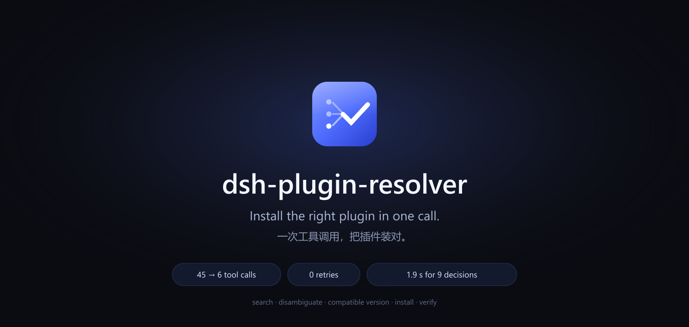
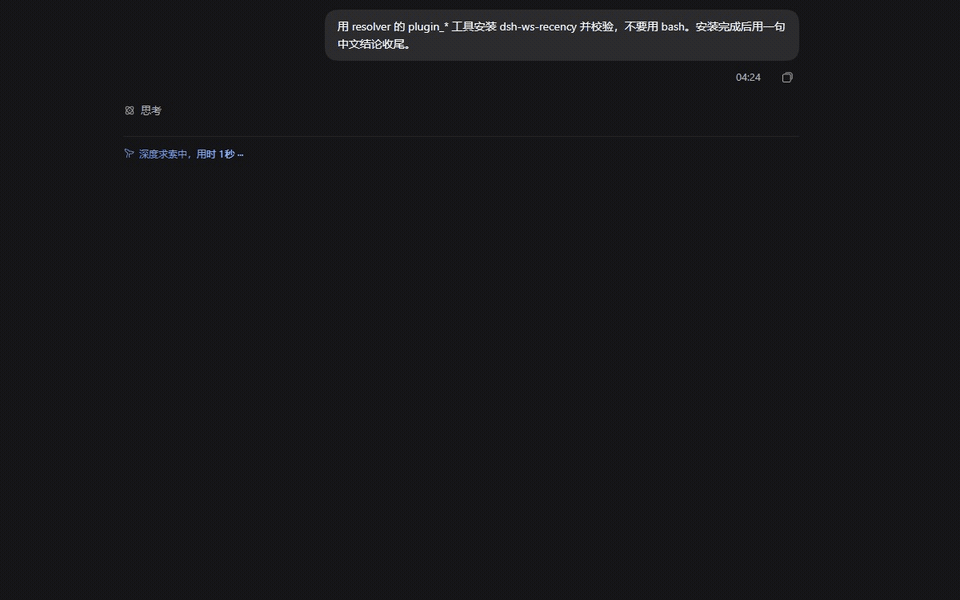
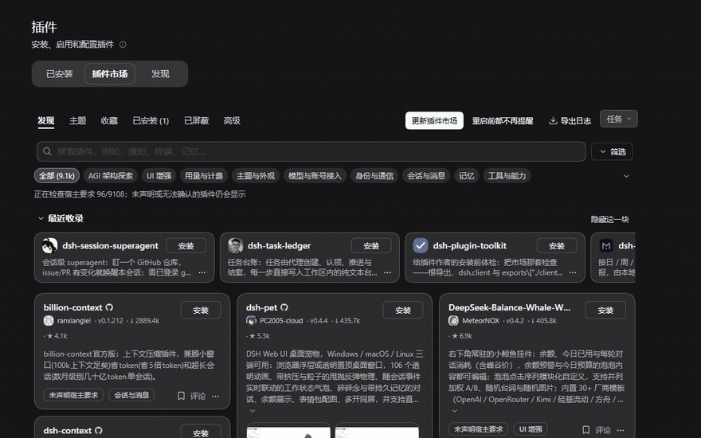
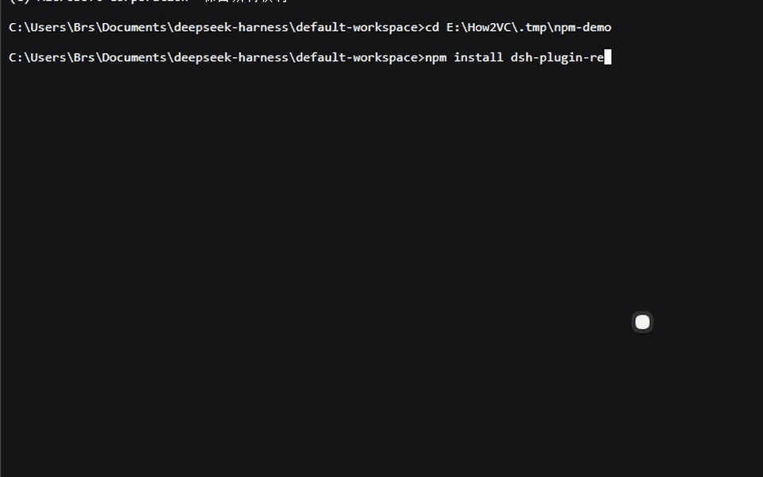
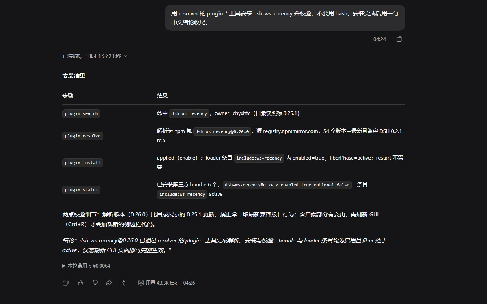

<p align="center">
  
</p>

<p align="center">
  <a href="README.md">简体中文</a> · <b>English</b>
</p>

<p align="center">
  <a href="https://www.npmjs.com/package/dsh-plugin-resolver"></a>
  <a href="https://github.com/sakikoTGW/dsh-plugin-resolver/actions/workflows/test.yml"></a>
  
  
  <a href="LICENSE"></a>
  
  
</p>

<p align="center"><sub><b>45 checks</b> · <b>dsh.so L5 run-verified</b> · <b>dshbase Verified</b> · MIT · DSH ≥0.2.0-rc.2 &lt;0.3.0 · Node ≥20</sub></p>

## What it does

<p align="center">
  
</p>

<p align="center"><sub>Real DSH session: one instruction → <code>plugin_search</code> → <code>plugin_resolve</code> → <code>plugin_install</code> → <code>plugin_status</code>. Installed <code>dsh-ws-recency@0.26.0</code> and read back enabled / active.</sub></p>

<p align="center"><b>45 → 6</b> tool calls · <b>0</b> failed retries · <b>20+ min → ~3 min</b> · <b>1.9 s</b> decision chain (9 calls)</p>

Ablation removes the catalog cache, same-name disambiguation, compatible-version solving and post-install verification in turn; the outcomes are wrong version, wrong source, installed but not mounted, silent failure. Data: [ABLATION](ABLATION.md). Comparison: [BENCHMARK](BENCHMARK.md).

## Install

| Plugin market (real UI) | npm (real terminal) |
|---|---|
|  |  |
| Search → confirm → install → installed (restart to apply) | `npm install dsh-plugin-resolver` → added 1 package in 8s |

Hand this to your agent:

```text
Install dsh-plugin-resolver, then use it to install dsh-browser.
```

<details>
<summary>Manual paths</summary>

Market index source:

```text
https://sakikoTGW.github.io/dsh-plugin-resolver/market/index.json
```

npm / DSH host:

```sh
dsh plugin --profile <profile> add dsh-plugin-resolver
```

GitHub source or tarball:

```sh
dsh plugin --profile <profile> add github:sakikoTGW/dsh-plugin-resolver#<commit>
```

</details>

## How it works

| Stage | Tool | Output |
|---|---|---|
| Search | `plugin_search` | Catalog hits, owner, stars, npm name, ambiguity marker |
| Resolve | `plugin_resolve` | Package, install spec, registry, source-build requirement |
| Install | `plugin_install` | Changes to profile / lockfile / plugin-sources |
| Verify | `plugin_status` | Bundle, loader entry, fiberPhase |
| Report | return value | Applied state, restart decision, next step |

`plugin_install` writes the environment; the other three tools are read-only.

## Ecosystem

- [dsh-plugins](https://github.com/sakikoTGW/dsh-plugins) — the plugin set
- [dsh.so](https://www.dsh.so/zh/artifact/dsh-plugin-resolver/) — L5 run-verified
- [dshbase](https://dshbase.com/plugins/dsh-plugin-resolver/) — Verified
- [dshmarket](https://dshmarket.com) — market listing
- Market index source: `https://sakikoTGW.github.io/dsh-plugin-resolver/market/index.json`

## Capability matrix

| Capability | npm | GitHub-only | Explicit spec |
|---|---|---|---|
| Same-name disambiguation | ✓ | ✓ | ✓ |
| Compatible version | ✓ | ✓ | Caller-specified |
| Source build | — | ✓ | Per spec |
| Post-install verification | ✓ | ✓ | ✓ |
| Restart decision | ✓ | ✓ | ✓ |

## Features

- **Same-name disambiguation** — `plugin_search` returns every candidate with owner, stars, npm name and install command; the caller supplies `owner=` or a full spec.
- **Compatible version** — `plugin_resolve` solves against `engines.dsh` and same-namespace peers, and returns a reviewable install spec.
- **GitHub source** — when build output is missing it runs `pnpm install` / `pnpm run build`, then installs through `link:`.
- **Post-install verification** — `plugin_status` reads back bundle, loader entry and fiberPhase; the plugin manager's application result drives the restart decision.

<p align="center">
  
</p>

## Validation

```sh
npm test   # 45 passing: 35 logic + 10 harness
```

The machine-readable validation entry lives in [`agent.json`](agent.json) under `validation`; CI lives in [test.yml](https://github.com/sakikoTGW/dsh-plugin-resolver/actions/workflows/test.yml).

## Agent contract

```json
{
  "tools": ["plugin_search (readOnly)", "plugin_resolve (readOnly)", "plugin_install (writes profile)", "plugin_status (readOnly)"],
  "versionRule": "engines.dsh authoritative; otherwise same-namespace @deepseek-ai/dsh peers",
  "ambiguity": "owner= or a full spec",
  "writes": ["profile", "lockfile", "plugin-sources"],
  "restart": "plugin manager result is authoritative"
}
```

Full contract: [`agent.json`](agent.json).

## Closing

One tool call, the right plugin.

[npm](https://www.npmjs.com/package/dsh-plugin-resolver) · [GitHub](https://github.com/sakikoTGW/dsh-plugin-resolver) · [Issues](https://github.com/sakikoTGW/dsh-plugin-resolver/issues) · [dsh-plugins](https://github.com/sakikoTGW/dsh-plugins)

<p align="center"><sub>Built for <a href="https://github.com/deepseek-ai/deepseek-harness">DeepSeek Harness</a> · MIT · <a href="#">Back to top ↑</a></sub></p>

