<p align="center">
  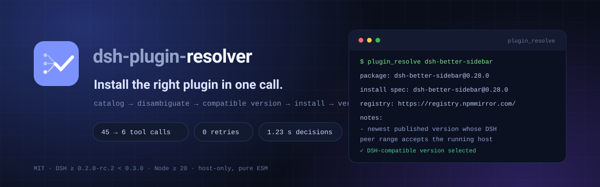
</p>

<p align="center">
  <strong>简体中文</strong> | <a href="README.en.md">English</a>
</p>

<p align="center">
  <a href="https://www.npmjs.com/package/dsh-plugin-resolver"></a>
  <a href="https://github.com/sakikoTGW/dsh-plugin-resolver/actions/workflows/test.yml"></a>
  
  <a href="LICENSE"></a>
  
  
</p>

# dsh-plugin-resolver

> **一次工具调用，把插件装对。**
>
> 搜索目录 → 同名消歧 → 按当前 DSH 内核选兼容版本 → registry / GitHub 源码安装 → 装后校验，一次走完。
>
> 实测装 1 个歧义 + 1 个 GitHub-only 插件：工具调用 **约 45 → 6**，耗时 **20+ 分钟 → 约 3 分钟**，失败重试 **0**。
>
> host-only 插件 · 4 个工具 · 纯 ESM 免构建 · DSH `>=0.2.0-rc.2 <0.3.0` · Node `>=20`

<p align="center">
  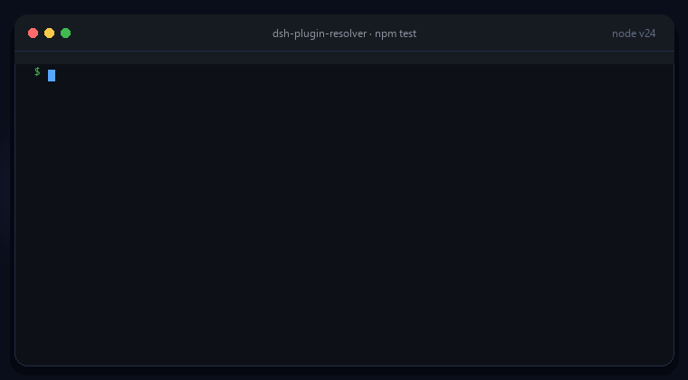
</p>
<p align="center"><sub>真实输出：<code>npm test</code> 39 项检查全绿（<a href="demo/demo.tape">VHS tape</a> 可重录）</sub></p>

## 目录

- [为什么需要它](#为什么需要它)
- [怎么工作](#怎么工作)
- [快速开始](#快速开始)
- [四个工具](#四个工具)
- [版本选择规则](#版本选择规则)
- [安装路径与重启判定](#安装路径与重启判定)
- [结构](#结构)
- [效果与证据](#效果与证据)
- [市场收录](#市场收录)
- [测试与 CI](#测试与-ci)
- [已知限制](#已知限制)
- [反馈与安全](#反馈与安全)
- [License](#license)

## 为什么需要它

给一台 DSH 装两个真实插件：`dsh-better-sidebar`（npm 上的 `latest` 不保证兼容当前内核）和 `dsh-browser`（6 个同名 owner、GitHub-only、还要本地构建）。把安装交给 agent 时，手工路径实际发生的是：

| 手工路径上会发生什么 | 代价（真机实测） |
|---|---|
| 从 GitHub Pages 拉一次社区目录（6.4 MB） | **91 s**，模型还得读大量条目 |
| 目录里 287 组同名，`dsh-browser` 一条就有 6 个 owner | 靠猜；其中 **51 组**星数最高的是 GitHub-only、同组却有 npm 包 |
| `latest` 未必兼容当前内核（peer 线或 `engines.dsh` 高于宿主） | 装上后被启动预检**静默禁用** |
| 直连 npmjs 慢 | 两次 **90 s 超时**，换镜像后 13.4 s |
| GitHub-only 仓库不提交构建产物 | `main` 指向不存在的文件——**装上了也永远不会加载** |
| 装完不知道有没有生效 | 还要另找手段回读 loader entry / 前端 boot 表 |

这个插件把这些**判断与验证**固化一次；之后每次安装只需要一次工具调用。

> 它不是官方 Discover 的替代品：对点 UI 的人，插件市场已经够好；它服务的是**把安装交给 agent 的人**。

## 怎么工作

<p align="center">
  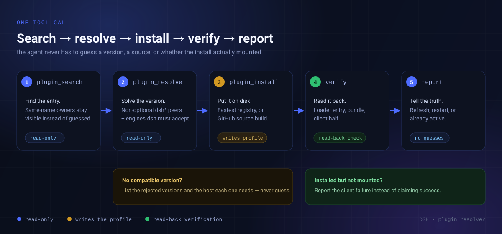
</p>
<p align="center"><sub>两条必须如实上报的失败路径也画在图里：没有兼容版本、装上了但没挂载。</sub></p>

四个工具里只有 `plugin_install` 会写环境；其余都是只读。歧义名、GitHub 源码、未知来源会先给出解析计划，不替你猜。

## 快速开始

第一次先把 resolver 装进来（约 10 秒）；从下一次安装开始，用户只需要说“帮我装 xxx”。

### 插件市场（推荐，图形界面）

`插件 → 实验性插件 → 打开自定义插件市场 → 发现 → 添加索引源`：

```text
https://sakikoTGW.github.io/dsh-plugin-resolver/market/index.json
```

然后安装 `dsh-plugin-resolver`。

### npm（已发布 `0.1.2`）

```sh
dsh plugin --profile <profile> add dsh-plugin-resolver
```

### GitHub 源码 / tarball

```sh
# 建议锁 commit
dsh plugin --profile <profile> add github:sakikoTGW/dsh-plugin-resolver#<commit>

# 或者本地打包
npm pack && dsh plugin --profile <profile> add ./dsh-plugin-resolver-0.1.2.tgz
```

装完重启一次宿主。之后：

```text
“帮我装 dsh-browser”          → 列出 6 个同名候选，要求 owner=，不猜
“装 dsh-builtin-browser”      → 选到与当前内核兼容的版本并装好
“帮我装 dsh-better-sidebar”   → latest 不兼容时自动降级，并说明跳过了哪些版本
```

<p align="center">
  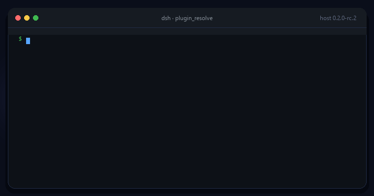
</p>
<p align="center"><sub>真实调用动画（本地 harness 捕获，宿主 0.2.0-rc.2）：从真实目录与 registry 解析出一个兼容版本。</sub></p>

真实调用长这样（宿主 0.2.0-rc.2）：

```text
$ plugin_resolve dsh-builtin-browser
target kind: npm   running DSH: 0.2.0-rc.2
package: dsh-builtin-browser@0.4.15
install spec: dsh-builtin-browser@0.4.15
registry: https://registry.npmmirror.com/
notes:
- newest of 41 published versions whose DSH peer range accepts 0.2.0-rc.2
```

安装调用还会带上校验与重启判定：

```text
$ plugin_install dsh-better-sidebar
target kind: npm   running DSH: 0.2.1-rc.2
package: dsh-better-sidebar@0.28.0
install spec: dsh-better-sidebar@0.28.0
...
restart: not required — manager applied the change in place
```

## 四个工具

| 工具 | 作用 | 是否改动环境 |
|---|---|---|
|  `plugin_search` | 搜社区目录（npm 载体优先），排序并显式标出同名歧义 | 只读 |
|  `plugin_resolve` | 只解析不装：目录条目、兼容版本、registry、是否需要源码构建 | 只读 |
|  `plugin_install` | 完整安装：选版本 → 安装/构建 → 回读校验 → 下一步提示 | 写 profile |
|  `plugin_status` | 已装 bundle / loader entry / fiberPhase 盘点 | 只读 |

<p align="center">
  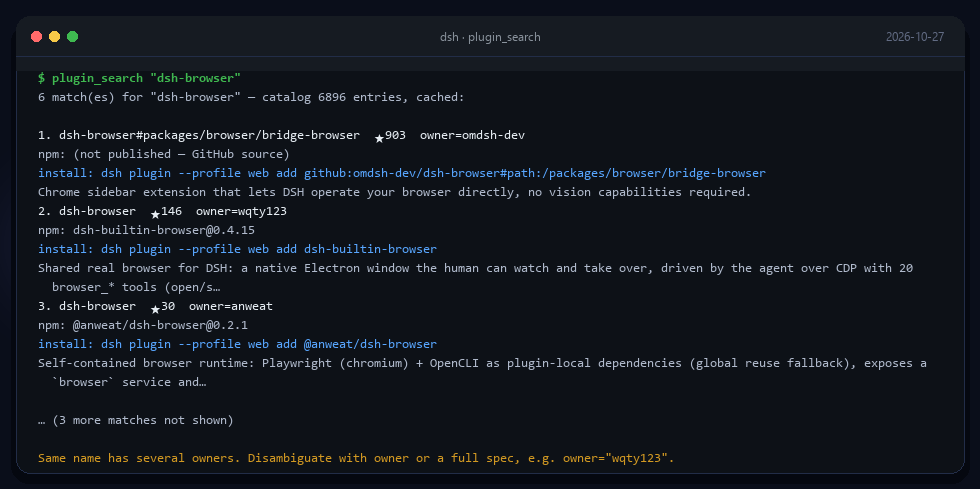
</p>
<p align="center"><sub>真实输出（本地 harness，2026-10-27）：同名歧义不会被猜，候选带 owner、星数、npm 名与安装命令。</sub></p>

<p align="center">
  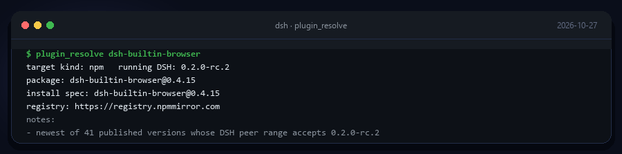
</p>
<p align="center"><sub>真实输出：只解析、不写环境，先给出一份可复核的安装计划。</sub></p>

## 版本选择规则

1. **运行时版本**取 `pluginManager.listBundles()` 里 `@deepseek-ai/dsh-base` 的版本；
2. 逐版本从高到低检查：非可选 **`@deepseek-ai/dsh*`** peer 必须满足运行时版本，声明了 **`engines.dsh`** 也要满足；
3. `@deepseek-ai/cordis`、`@deepseek-ai/schemastery` 等**同命名空间但不同版本线**的库**不算**运行时约束——这条曾把 4/8 个包误判成“无兼容版本”（见 [ABLATION](ABLATION.md)）；
4. 取第一个通过者；全不通过时列出最近版本的拒绝原因；用户显式给 `version` 时跳过求解。

## 安装路径与重启判定

- **registry 包**：`pluginManager.installBundle(name@resolved, { registry })`，profile / lockfile / 激活生命周期都交给插件管理器；
- **GitHub-only**：检出到 `$DSH_HOME/plugin-sources/<owner>__<repo>`，缺构建产物且声明了 `build` 时执行 `pnpm install` + `pnpm run build`，随后 `installBundle('link:<pkgDir>')`，已构建的检出直接复用；
- **显式 spec**（`github:` / `link:` / `file:` / `https:`）：原样交给插件管理器。

`plugin_install` 不再无条件要求重启；安装前后会比较 `listBundles()` 的 bundle 集合与运行时文件 hash（排除 README / docs / 版本号），新增 bundle 以管理器的应用结果为准：

| 变化 | 结果 |
|---|---|
| 无变化 / 仅版本号 / 管理器就地应用（含新增 bundle 的 HMR 重组合） | `restart: not required` |
| 管理器要求重启（bundle 新增、运行时代码变化、client 半变化） | `restart: required — <原因>` |
| 带 client 半的新插件 | 额外提示刷新 GUI |

## 结构

<p align="center">
  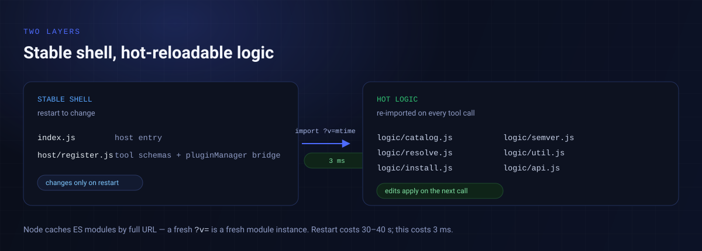
</p>
<p align="center"><sub>稳定壳改动要重启；<code>logic/</code> 改动下一次工具调用就生效。</sub></p>

`host/register.js` 每次调用计算 `logic/` 下最大 mtime，以 `import('./logic/api.js?v=<mtime>')` 导入；逻辑模块之间用同一个 `?v=` 传递依赖。Node 的 ESM 缓存按完整 URL 计，于是：

- 改 `logic/` 任何文件 → **下一次工具调用立即生效**，不用重启宿主（实测 3 ms，重启约 30–40 s）
- 只有改动工具定义层（`index.js` / `host/register.js`）才需要重启

这是为无 HMR 的打包运行环境设计的：宿主拿不到真 HMR 所需的 Node 内部模块加载器，但“重新 import 一个带新 query 的模块”完全可行。

## 效果与证据

<p align="center">
  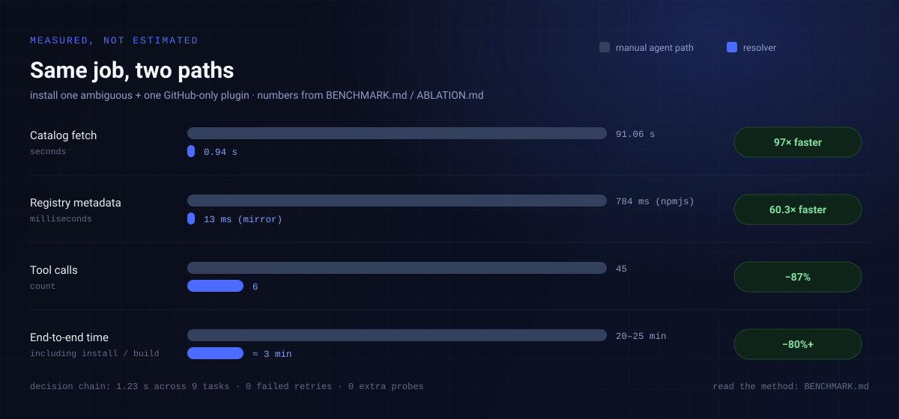
</p>
<p align="center"><sub>同一件事的两种路径；数字来自 <a href="BENCHMARK.md">BENCHMARK.md</a> 与 <a href="ABLATION.md">ABLATION.md</a>。</sub></p>

| 指标 | agent 手工路径 | 本插件 | 来源 |
|---|---|---|---|
| 工具调用（1 歧义 + 1 GitHub-only） | ≈ 45 次 | **≈ 6 次** | [BENCHMARK](BENCHMARK.md) |
| 端到端耗时 | 20–25 分钟 | **约 3 分钟**（含不可压缩的安装/编译） | [BENCHMARK](BENCHMARK.md) |
| 决策链耗时 | 每次重新推 | **1.23 s（9 次调用）** | [BENCHMARK](BENCHMARK.md) |
| 目录获取 | 91.06 s / 6.4 MB | **0.94 s / 2 个请求** | [BENCHMARK](BENCHMARK.md) |
| 安装失败重试 | 2 次 90 s 超时 | **0 次** | 会话日志 |
| 安装后额外探测 | 2 次 | **0 次** | [BENCHMARK](BENCHMARK.md) |

消融测试逐项拆能力，结果不是“慢一点”，而是**装错版本 / 装错来源 / 装完不加载 / 静默失败**：

- 目录 5,065 条，287 组同名；**51 组**“按星数/第一个命中”会装到另一条来源
- 8 个真实包里 **2 个 `latest` 与宿主不兼容**；朴素 peer 判断会把 **4/8** 误判成“装不了”
- 同一份 registry 元数据：npmjs **784 ms** vs 镜像 **13 ms**（60.3×）
- GitHub-only 仓库入口探针 **404**（只有源码，没有构建产物）
- 模拟“安装器报成功但进程里没有 entry”：无校验会**把静默失败报成成功**
- 逻辑热加载 **3 ms** vs 重启 **30–40 s**

完整方法与口径见 [BENCHMARK.md](BENCHMARK.md) 与 [ABLATION.md](ABLATION.md)。数字只覆盖判断、试错与验证；**下载和编译的物理时间压不掉**。

## 市场收录

<p align="center">
  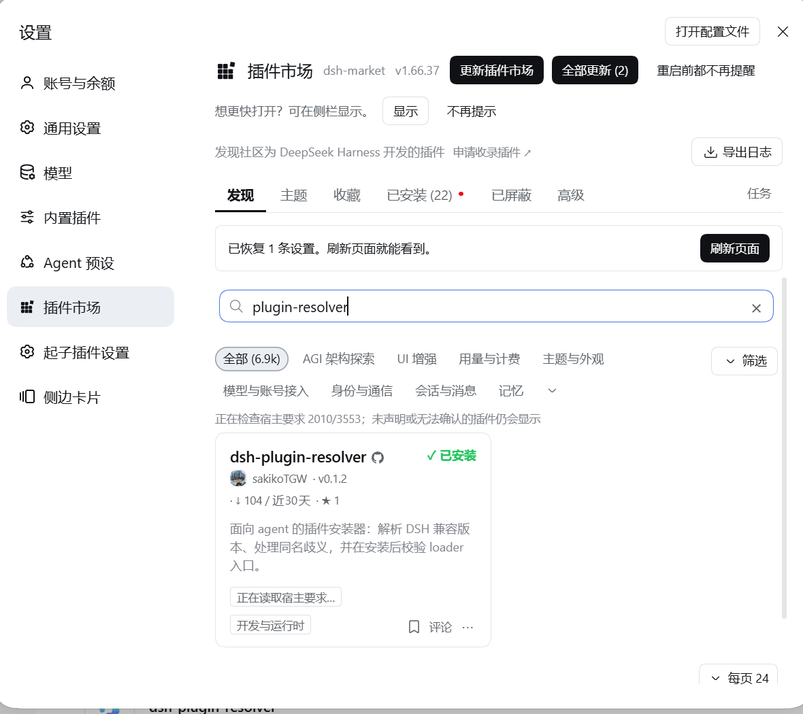
</p>
<p align="center"><sub>DSH 设置 → 插件市场 → 发现（搜索 <code>plugin-resolve</code>，2026-10-27 截图）：已安装 <code>v0.1.2</code>。</sub></p>

<p align="center">
  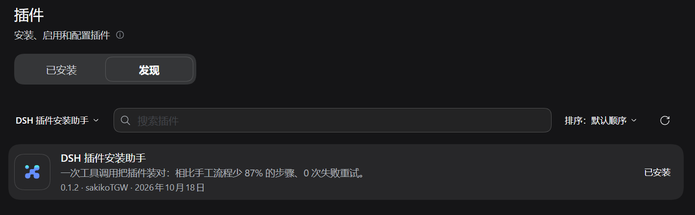
</p>
<p align="center"><sub>DSH 桌面版 → 插件 → 发现（已添加本仓库索引源）里的样子（2026-10-27 截图）。</sub></p>

<p align="center">
  <a href="https://www.dsh.so/zh/artifact/dsh-plugin-resolver/">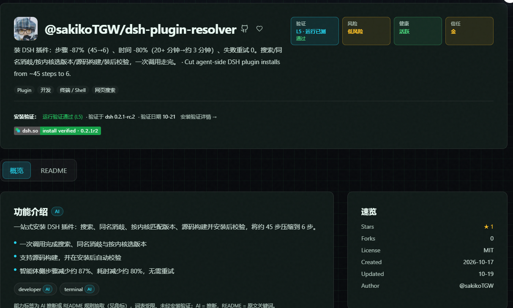</a>
</p>
<p align="center"><sub><a href="https://www.dsh.so/zh/artifact/dsh-plugin-resolver/">dsh.so</a> 收录页（2026-10-27 截图）：L5 运行已验证 · 低风险 · MIT。</sub></p>

<p align="center">
  <a href="https://dshbase.com/plugins/dsh-plugin-resolver/">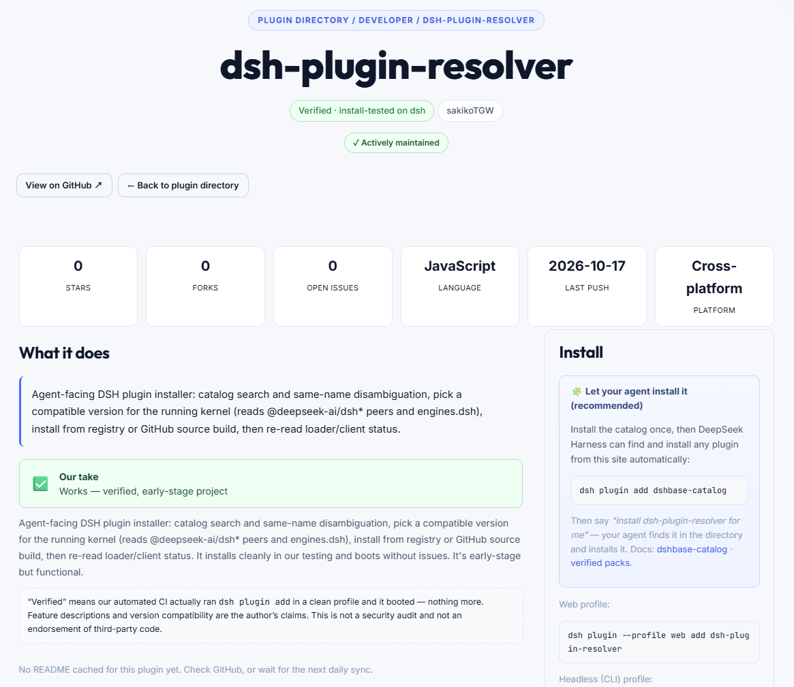</a>
</p>
<p align="center"><sub><a href="https://dshbase.com/plugins/dsh-plugin-resolver/">dshbase</a> 收录页（2026-10-27 截图）：Verified · install-tested on dsh · Actively maintained。</sub></p>

收录状态与提交记录维护在 [PUBLISHING.md](PUBLISHING.md)。

## 测试与 CI

```sh
npm test        # 29 条离线逻辑检查 + 10 条宿主无关 harness = 39 项
npm run bench   # 插件路径基准（真实目录 + registry）
npm run ablate  # 消融测试（无副作用）
```

- `test/selftest.mjs`：semver 子集、版本选择、spec 解析、目录检索（离线）
- `test/harness.mjs`：假 Cordis ctx + 假 pluginManager 驱动真实工具体
- `test/benchmark.mjs` / `test/ablation.mjs`：真实目录 + 真实 registry 的测量脚本
- CI：每次 push/PR 跑 `test`（Node 24）；`ablation` 走手动 / 每周定时任务

> 沙箱或 CI 里默认缓存目录不可写时，用 `DSH_HOME` 指到临时目录即可：`DSH_HOME=/tmp/dsh npm test`。

## 已知限制

- 兼容性以 npm 元数据里的 peer / `engines.dsh` 为准，宿主启动预检另有判断时以宿主为准；
- **替换已加载插件**仍需要重启宿主（loader 模块缓存 + 打包宿主无 Node 内部 loader）；**新增 bundle** 只看管理器的应用结果：管理器就地应用（HMR 重组合）时不再报 `restart-required`，只有它自己要求重启时才报；带 client 半的新插件会额外提示刷新 GUI；
- 同名歧义不猜，需要调用方给 `owner=` 或完整 spec；
- 目录是社区维护的第三方列表，插件只保证“按声明来源装对版本”，不做安全审计；
- GitHub 源码构建依赖宿主环境里的 `pnpm`（PATH 或 `DSH_PNPM_PATH`）与 `tar`，大仓库首次构建较慢。

## 反馈与安全

- 一般问题、功能建议：<https://github.com/sakikoTGW/dsh-plugin-resolver/issues>
- 安全问题：请走 **Security → Advisories → Report a vulnerability**（私密报告，不要开公开 Issue）
- 发布流程与清单：见 [PUBLISHING.md](PUBLISHING.md)

## License

[MIT](LICENSE)

<p align="center">
  <sub>Built for <a href="https://github.com/deepseek-ai/deepseek-harness">DeepSeek Harness</a> · 属于 <a href="https://github.com/sakikoTGW/dsh-plugins">dsh-plugins</a> 插件集 · 图标与横幅源码在 <a href="assets/">assets/</a> · <a href="#dsh-plugin-resolver">回到顶部 ↑</a></sub>
</p>
