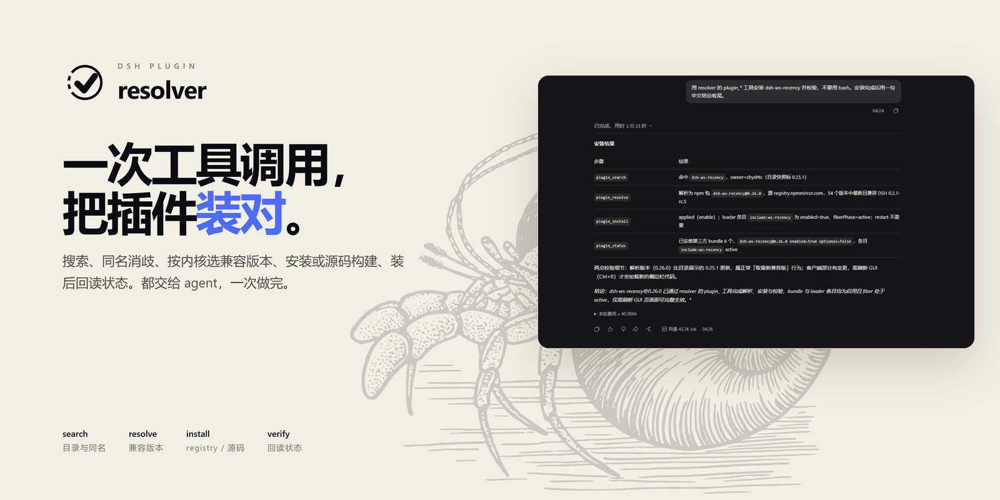
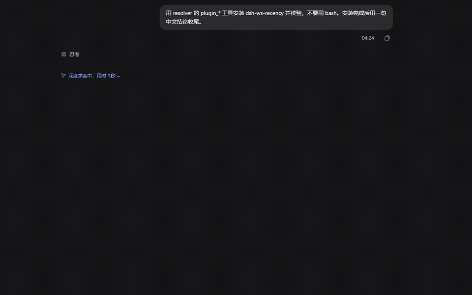
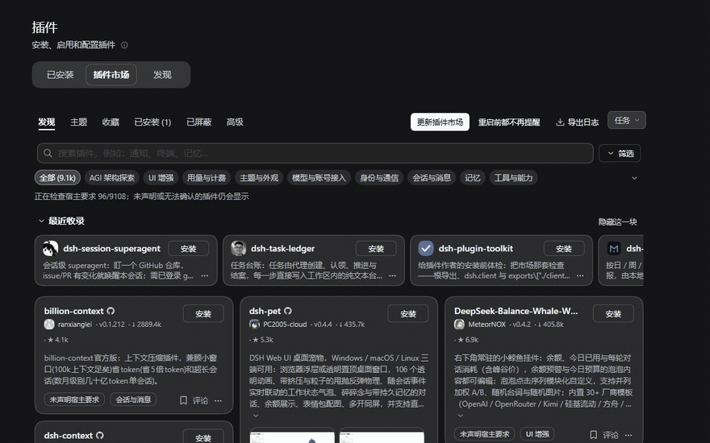
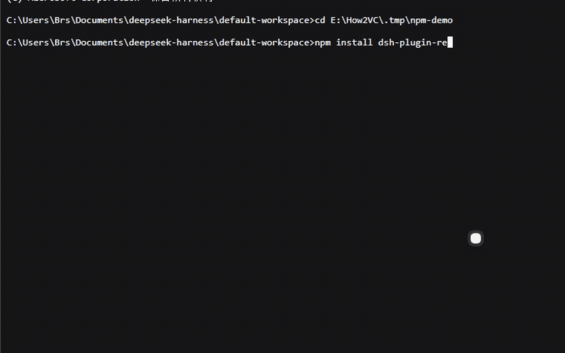

<p align="center">
  
</p>

<p align="center">
  <b>简体中文</b> · <a href="README.en.md">English</a>
</p>

<p align="center">
  <a href="https://www.npmjs.com/package/dsh-plugin-resolver"></a>
  <a href="https://github.com/sakikoTGW/dsh-plugin-resolver/actions/workflows/test.yml"></a>
  
  <a href="LICENSE"></a>
</p>

<p align="center"><sub>45 项检查 · dsh.so L5 运行已验证 · dshbase Verified · DSH ≥0.2.0-rc.2 &lt;0.3.0 · Node ≥20</sub></p>

我做这个插件，是因为让 agent 装插件这件事一直不太靠谱。社区目录 8MB，从 GitHub Pages 拉一次要一分半；406 组同名，`dsh-browser` 一组就有 9 个 owner；npm 上的 `latest` 不一定兼容当前内核，装上会被静默禁用；GitHub-only 的仓库没有构建产物，`main` 指向一个不存在的文件，装完永远不加载。

这些判断每次都要重来。我把它们做进插件里，之后装插件就是一次工具调用。

如果你就是 agent，先看 [`llms.txt`](llms.txt)，完整契约在 [`agent.json`](agent.json)。

## 这是它跑起来的样子

<p align="center">
  
</p>

<p align="center"><sub>真实 DSH 会话，装的是 <code>dsh-ws-recency@0.26.0</code>。它自己搜目录、解析版本、装完回读状态。</sub></p>

同一件事手工做要 45 次工具调用、20 多分钟；它 6 次，约 3 分钟，中间没有重试。测法和消融在 [BENCHMARK](BENCHMARK.md) 和 [ABLATION](ABLATION.md)。

## 安装

| 插件市场 | npm |
|---|---|
|  |  |

我平时直接跟 agent 说：

```text
安装 dsh-plugin-resolver，然后用它安装 dsh-browser。
```

<details>
<summary>自己敲命令</summary>

市场索引源：

```text
https://sakikoTGW.github.io/dsh-plugin-resolver/market/index.json
```

```sh
dsh plugin --profile <profile> add dsh-plugin-resolver
```

GitHub 源码或 tarball：

```sh
dsh plugin --profile <profile> add github:sakikoTGW/dsh-plugin-resolver#<commit>
```

</details>

## 它怎么工作

| 阶段 | 工具 | 结果 |
|---|---|---|
| 搜索 | `plugin_search` | 目录命中、owner、星数、npm 名、同名标记 |
| 解析 | `plugin_resolve` | package、install spec、registry、是否需要源码构建 |
| 安装 | `plugin_install` | profile、lockfile、plugin-sources 的变更 |
| 校验 | `plugin_status` | bundle、loader entry、fiberPhase |
| 上报 | 返回值 | 应用状态、restart 判定、下一步 |

只有 `plugin_install` 会写环境，其余三个只读。

## 生态

- [dsh-plugins](https://github.com/sakikoTGW/dsh-plugins)：插件集和 catalog
- [dsh.so](https://www.dsh.so/zh/artifact/dsh-plugin-resolver/)：L5 运行已验证
- [dshbase](https://dshbase.com/plugins/dsh-plugin-resolver/)：Verified
- 市场索引源：`https://sakikoTGW.github.io/dsh-plugin-resolver/market/index.json`

## 能做什么

| 能力 | npm | GitHub-only | 显式 spec |
|---|---|---|---|
| 同名消歧 | ✓ | ✓ | ✓ |
| 兼容版本 | ✓ | ✓ | 你给定 |
| 源码构建 | — | ✓ | 按 spec |
| 装后校验 | ✓ | ✓ | ✓ |
| 重启判定 | ✓ | ✓ | ✓ |

## 几个细节（Features）

- 同名插件它不替你选。搜索结果会把 owner、星数、npm 名都列出来，你给 `owner=` 或者完整 spec 就行。
- 兼容版本按 `engines.dsh` 和同命名空间的 peer 求解；解析结果是一份可以复核的 install spec。
- GitHub-only 的包缺构建产物时，它会先 `pnpm install` / `pnpm run build`，再以 `link:` 装进去。
- 装完回读 bundle、loader entry 和 fiberPhase，重启与否看插件管理器实际应用的结果。

## 验证

```sh
npm test   # 45 passing: 35 logic + 10 harness
```

机器可读的验证入口在 [`agent.json`](agent.json) 的 `validation`；CI 在 [test.yml](https://github.com/sakikoTGW/dsh-plugin-resolver/actions/workflows/test.yml)。

## 给 agent 的契约

```json
{
  "tools": ["plugin_search", "plugin_resolve", "plugin_install", "plugin_status"],
  "versionRule": "engines.dsh first; otherwise same-namespace @deepseek-ai/dsh peers",
  "ambiguity": "owner= or a full spec",
  "writes": ["profile", "lockfile", "plugin-sources"],
  "restart": "plugin manager result"
}
```

完整契约在 [`agent.json`](agent.json)，给 agent 的索引入口是 [`llms.txt`](llms.txt)。有问题来 [Issues](https://github.com/sakikoTGW/dsh-plugin-resolver/issues)，或者看 [dsh-plugins](https://github.com/sakikoTGW/dsh-plugins)。

<p align="center"><sub>MIT · <a href="https://github.com/deepseek-ai/deepseek-harness">DeepSeek Harness</a> · <a href="#">回到顶部</a></sub></p>
