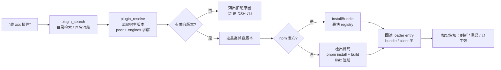

# dsh-plugin-resolver

**让 agent 自己把 DSH 插件装明白。**
搜索 → 同名消歧 → 按当前内核选兼容版本 → 安装（registry 或 GitHub 源码构建）→ 装后校验，一次调用走完。

[](https://github.com/sakikoTGW/dsh-plugin-resolver/actions/workflows/test.yml)
[](https://github.com/sakikoTGW/dsh-plugin-resolver/actions/workflows/ablation.yml)
[](LICENSE)
[](package.json)
[](https://github.com/deepseek-ai/deepseek-harness)
[](test)
[](https://github.com/sakikoTGW/dsh-plugin-resolver/stargazers)

> **装两个典型插件：工具操作 −87%（45 → 6 次），实际耗时 −80%（20+ 分钟 → 约 3 分钟），失败重试 0。**
>
> 搜索 → 同名消歧 → 按当前内核选兼容版本 → 安装（registry / GitHub 源码构建）→ 装后校验，一次调用走完。
> host-only 插件，给 DSH 加 4 个模型工具，不注册服务、没有前端、纯 ESM 免构建。

---

## 为什么要它

**场景**：给一台 DSH `0.2.0-rc.2` 装两个真实插件——`dsh-better-sidebar`（npm 上的 latest 要求更高内核）和 `dsh-browser`（6 个同名 owner、GitHub-only、还要本地构建扩展）。当时在 agent 侧，这是这样一串手工活：

| 实际会发生的事 | 代价（真机实测） |
|---|---|
| 目录在 GitHub Pages 上，拉一次 6.4 MB | **91 s**，模型还得读一堆条目 |
| 同一个名字有多个 owner（`dsh-browser` 有 6 个） | 靠猜，猜错就装错来源 |
| `latest` 未必兼容当前内核（如 `0.28.0` 要 `^0.2.1-rc.1`，宿主是 `0.2.0-rc.2`） | 装上后启动预检把它静默禁用 |
| 直连 npmjs 慢 | 两次 **90 s 超时**，换镜像后 13.4 s |
| GitHub-only 仓库不提交构建产物 | `dsh plugin add github:…` 装了个 `main` 指向不存在文件的包 |
| 装完不知道有没有生效 | 需要另找手段回读 loader entry / 前端 boot 表 |

这个插件的存在意义：把上面这些**判断与验证**固化一次，之后每次只需一次工具调用。

## 怎么工作



## 30 秒上手

要求 **DSH `>=0.2.0-rc.2 <0.3.0`**（已在 `engines.dsh` 声明）。纯 JS、无构建、无 install 脚本，三种方式都不需要 `allowBuilds` 授权：

```sh
# npm（官方推荐，发布后）
dsh plugin --profile web add dsh-plugin-resolver
# GitHub 源码安装（建议锁 commit）
dsh plugin --profile web add github:sakikoTGW/dsh-plugin-resolver#<commit>
# tarball
npm pack && dsh plugin --profile web add ./dsh-plugin-resolver-0.1.0.tgz
```

装完（宿主重启后最稳）直接说：

> "帮我装 dsh-browser" → 它会先问/列出 6 个同名候选；
> "装 dsh-builtin-browser" → 自动选到与你内核兼容的版本并装好。

真实调用长这样：

```text
$ plugin_resolve dsh-builtin-browser
target kind: npm   running DSH: 0.2.0-rc.2
package: dsh-builtin-browser@0.4.13
install spec: dsh-builtin-browser@0.4.13
registry: https://registry.npmmirror.com/
notes:
- newest of 39 published versions whose DSH peer range accepts 0.2.0-rc.2
```

```text
$ plugin_resolve dsh-better-sidebar
package: dsh-better-sidebar@0.26.1
skipped versions:
- 0.28.0: @deepseek-ai/dsh-agent needs ^0.2.1-rc.1, host is 0.2.0-rc.2
```

## 四个工具

| 工具 | 作用 | 是否改动环境 |
|---|---|---|
| `plugin_search` | 搜社区目录（npm 载体优先），排序并显式标出同名歧义 | 只读 |
| `plugin_resolve` | 只解析不装：目录条目、兼容版本、registry、是否需要源码构建 | 只读 |
| `plugin_install` | 完整安装：选版本 → 安装/构建 → 回读校验 → 下一步提示 | 写 profile |
| `plugin_status` | 已装 bundle / loader entry / fiberPhase 盘点 | 只读 |

## 版本选择规则

1. 运行时版本 = `pluginManager.listBundles()` 里 `@deepseek-ai/dsh-base` 的版本；
2. 逐版本从高到低检查：非可选 **`@deepseek-ai/dsh*`** peer 必须满足运行时版本；声明了 **`engines.dsh`** 也要满足；
3. `@deepseek-ai/cordis`、`@deepseek-ai/schemastery` 等**同命名空间但不同版本线**的库**不算**运行时约束（这条曾把 4/8 个包误判成"无兼容版本"，见 [ABLATION](ABLATION.md)）；
4. 取第一个通过者；全不通过时列出最近版本的拒绝原因；用户显式给 `version` 时跳过求解。

## 安装路径

- **registry 包**：`pluginManager.installBundle(name@resolved, { registry })`，profile/lockfile/激活生命周期都交给插件管理器；
- **GitHub-only**：检出到 `$DSH_HOME/plugin-sources/<owner>__<repo>`，缺构建产物且声明了 `build` 时执行 `pnpm install` + `pnpm run build`，随后 `installBundle('link:<pkgDir>')`，已构建的检出直接复用；
- **显式 spec**（`github:` / `link:` / `file:` / `https:`）：原样交给插件管理器。

## 结构：稳定壳 + 可热加载逻辑

```
index.js           宿主入口（稳定）
host/register.js   工具 schema + pluginManager 桥接（稳定，改动需重启）
logic/             目录 / 版本 / 兼容 / 安装编排（每次调用按 mtime 重新 import）
```

`host/register.js` 每次调用计算 `logic/` 下最大 mtime，以 `import('./logic/api.js?v=<mtime>')` 导入；逻辑模块之间用同一 `?v=` 传递依赖。Node 的 ESM 缓存按完整 URL 计，因此：

- **改 `logic/` 任何文件 → 下一次工具调用立即生效，不用重启宿主**
- 只有改动工具定义层（`index.js` / `host/register.js`）才需要重启

这是为打包桌面版设计的：它拿不到真 HMR 所需的 Node 内部模块加载器，但"重新 import 一个带新 query 的模块"完全可行。

## 效果

| 指标 | 手工路径 | 本插件 | 来源 |
|---|---|---|---|
| 工具调用（装 1 歧义 + 1 GitHub-only 插件） | ≈ 45 次 | **≈ 6 次** | [BENCHMARK](BENCHMARK.md) |
| 决策链耗时 | — | **1.23 s / 9 个决策任务** | benchmark.mjs |
| 目录获取 | 91.06 s / 6.4 MB | **0.94 s / 2 请求** | benchmark.mjs |
| 安装失败重试 | 2 次 90 s 超时 | **0 次** | 会话日志 |
| 安装后校验调用 | 2 次额外探测 | **0 次** | benchmark.mjs |

消融测试（逐项拆能力）见 [ABLATION.md](ABLATION.md)：同名 287 组、naive 会选错 51 组；8 个真实包中 2 个 latest 不兼容；镜像元数据延迟比 60.3×；GitHub-only 入口探针 404；静默失败可检测；逻辑热加载 3 ms vs 重启 30–40 s。

```sh
node test/benchmark.mjs   # 插件路径基准
node test/ablation.mjs    # 消融测试（无副作用）
```

## 测试与 CI

```sh
npm test        # = selftest(19) + harness(10)
npm run bench   # 基准
npm run ablate  # 消融
```

- `test/selftest.mjs`：semver 子集、版本选择、spec 解析、目录检索（离线）
- `test/harness.mjs`：假 Cordis ctx + 假 pluginManager 驱动真实工具体
- `test/benchmark.mjs` / `test/ablation.mjs`：真实目录 + 真实 registry 的测量脚本
- CI：每次 push 跑 `test`；`ablation` 走手动/每周定时任务

## 已知限制

- 兼容性以 npm 元数据里的 peer / `engines.dsh` 为准，宿主启动预检另有判断时以宿主为准；
- **替换已加载插件**仍需要重启宿主（loader 模块缓存 + 打包 Electron 无 Node 内部 loader），插件会如实报 `restart-required`；
- 同名歧义不猜，需要调用方给 `owner=` 或完整 spec；
- 目录是社区维护的第三方列表，插件只保证"按声明来源装对版本"，不做安全审计；
- GitHub 源码构建依赖本机 `pnpm`（优先 `$DSH_HOME/.desktop-bin/pnpm*`）与 `tar`，大仓库首次构建较慢。

## License

[MIT](LICENSE)
