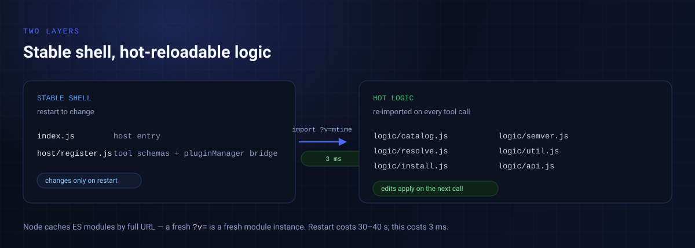

# 结构

`host/register.js` 每次调用计算 `logic/` 下最大 mtime，以 `import('./logic/api.js?v=<mtime>')` 导入；逻辑模块之间用同一个 `?v=` 传递依赖。Node 的 ESM 缓存按完整 URL 计，所以：

- 改 `logic/` 任何文件，下一次工具调用立即生效，不用重启宿主（实测 2–5 ms，重启约 30–40 s）。
- 只有改工具定义层（`index.js` / `host/register.js`）才需要重启。

这是为没有 HMR 的打包运行环境设计的：宿主拿不到真 HMR 所需的 Node 内部模块加载器，但重新 import 一个带新 query 的模块完全可行。

