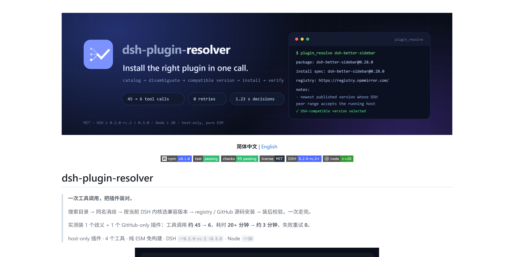
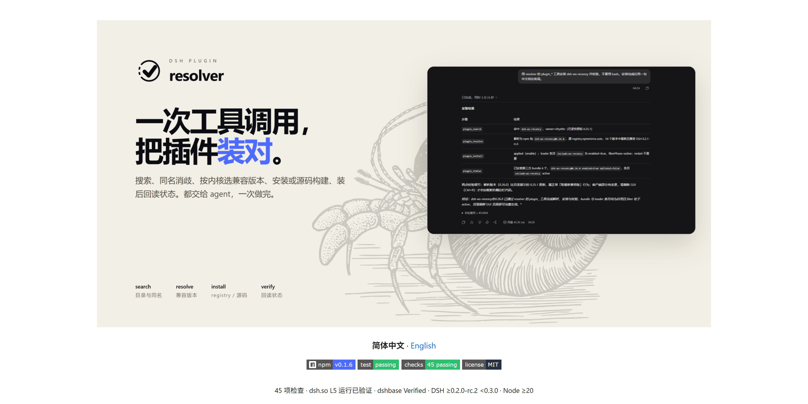
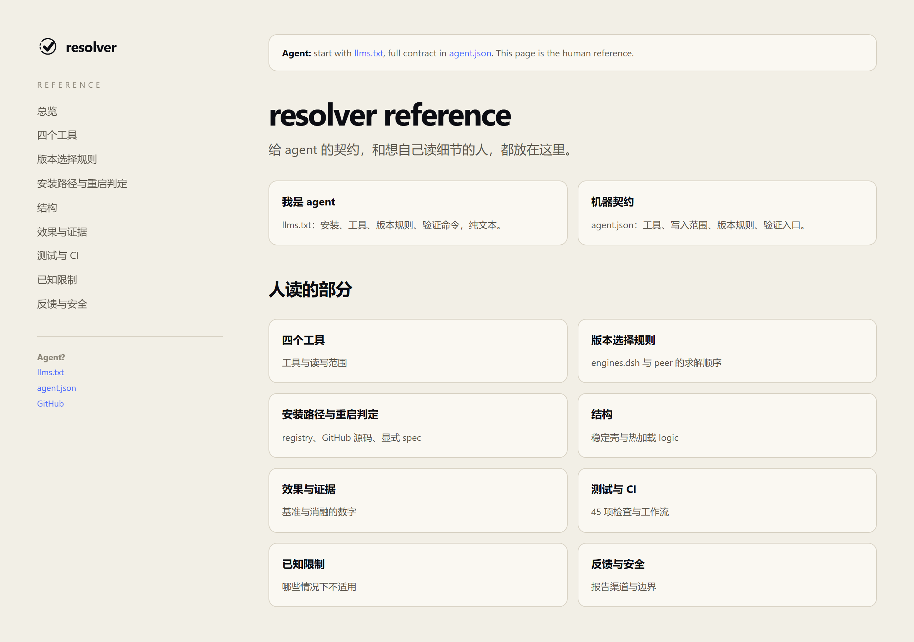

# v0.1.6 — 从横幅到仓库：首屏、README、agent 层

Status: released (GitHub) / npm still 0.1.4
Compare: https://github.com/sakikoTGW/dsh-plugin-resolver/compare/v0.1.3...v0.1.6

## 一句话

几天前它是一张渐变横幅加三颗指标胶囊；现在首屏是一张纸色海报，README 后面接着一套 agent 和人都能读的参考层。

## 改了什么 → 改后效果

| 改了什么 | 之前 | 之后 | 证据 |
|---|---|---|---|
| 首屏重做 | 渐变横幅、3 个数字胶囊、终端卡片 | 纸色海报、左大字、右真实 DSH 窗口、公共领域寄居蟹版画水印 | [before](https://raw.githubusercontent.com/sakikoTGW/dsh-plugin-resolver/main/docs/releases/v0.1.6/before-readme.png) / [after](https://raw.githubusercontent.com/sakikoTGW/dsh-plugin-resolver/main/docs/releases/v0.1.6/after-readme.png) |
| README 减重 | 282 行、14 个二级章节、22 张图、6 个徽章 | 142 行、9 个二级章节、8 张图（含 4 个徽章）、第一人称来由 | `repo_verify` 84/B；README 统计见 `evidence.txt` |
| 去掉模板腔 | 数据条、箭头链、重复 slogan、每节同一套排比 | 数字只在正文出现一次；没有 KPI 条；结尾是参考索引 | README v0.1.3 vs v0.1.6 |
| 新增参考层 | 没有 docs 站点，agent 只能读 README | `agent.json` + `llms.txt` + 9 页 docs 参考站点 | [docs 首页](https://sakikoTGW.github.io/dsh-plugin-resolver/docs/)；[截图](https://raw.githubusercontent.com/sakikoTGW/dsh-plugin-resolver/main/docs/releases/v0.1.6/docs-site.png) |
| 参考索引 | 无 | README 末尾 `## 参考` 指向四工具、版本规则、安装路径、结构、证据、测试、限制、安全 | README 末尾 |
| 发布报告 | 发版只有 release 一句话 | 本报告：before/after、素材、证据、已知问题 | 本文件 |

## 和几天前（v0.1.3）的区别

| 维度 | v0.1.3 | 现在 v0.1.6 | 影响 |
|---|---|---|---|
| 版本 | 0.1.3 | 0.1.6 | GitHub release 是 0.1.6；npm latest 还是 0.1.4 |
| README | 282 行 / 14 节 / 22 图 / 6 徽章 | 142 行 / 9 节 / 8 图 / 4 徽章 | 首屏信息更少，但每屏只有一个主视觉 |
| 首屏 | 渐变横幅 + 指标胶囊 + 终端 | 纸色海报 + 真实 DSH 窗口 + 版画水印 | 从“设计素材”变成“产品证据” |
| Agent 层 | 无 | `llms.txt` + `agent.json` + docs 站点 | agent 不用只靠 Markdown 散文 |
| docs | 0 页 | 9 页（总览 + 8 个参考页） | 想深读的人有地方去 |
| 验证 | 45 项；`repo_verify` 81/B | 45 项；`repo_verify` 84/B | 工具契约没变，文档结构更好 |
| 工具 | 4 个 | 4 个 | 无破坏性变更 |

谁需要做什么：

- 新读者：先看首屏，再看「这是它跑起来的样子」；细节去 README 末尾的参考索引。
- 已有用户：插件行为不变，升级不需要改调用。
- Agent：读 `llms.txt` 和 `agent.json`；不要再从 README 散文里猜契约。

## 图片对比

| 几天前 v0.1.3 | 现在 v0.1.6 |
|---|---|
|  |  |

图注：同一份 README 的首屏渲染；不是拿旧横幅重排，而是把 v0.1.3 的 README 实际渲染出来。



图注：README 末尾的参考索引，落到一个有左导航、agent/人两个入口的站点。

## 素材

| 文件 | 说明 | 来源 |
|---|---|---|
| `before-readme.png` | v0.1.3 README 首屏的实际渲染 | `git worktree` at `v0.1.3` + 本地 GitHub 风格渲染 |
| `after-readme.png` | 当前 README 首屏的实际渲染 | 当前 worktree |
| `before-hero.png` | v0.1.3 横幅资产单独放在 1600×800 纸面上 | `assets/banner.svg` |
| `after-hero.png` | 当前首屏海报资产 | `assets/hero-zh.png` |
| `docs-site.png` | 当前 docs 首页 | GitHub Pages / 本地渲染 |
| `agent-before.json` | v0.1.3 没有 agent 层 | tag |
| `agent-after.json` | 当前机器契约 | `agent.json` |
| `evidence.txt` | README 统计、测试、verify | 真实命令 |

## 升级路径

```sh
dsh plugin --profile <profile> add dsh-plugin-resolver
```

从 v0.1.3 升级不需要改调用；四个工具的名字、输入、输出没变。想直接看文档：

```text
https://sakikoTGW.github.io/dsh-plugin-resolver/docs/
```

## 破坏性变更

无工具契约变更。变化的只有 README 结构和新增的 docs/agent 文件；旧的 README 目录锚点不再保留，外部如果链到旧章节需要改到参考索引。

## 已知问题

- npm latest 还是 0.1.4；0.1.5/0.1.6 处于 staged，需要 2FA 批准或 OTP。
- `before-readme.png` / `after-readme.png` 是用本地 GitHub 风格 CSS 渲染的，不是 GitHub 页面原图；徽章由 shields 实时加载。
- 寄居蟹是版画水印，不是吉祥物；它只出现在首屏背景。
- 英文版首屏仍然用中文 DSH 截图，因为英文界面还没有重录。

## 证据

```text
README v0.1.3: 282 lines / 14 h2 / 22 images / 6 badges
README v0.1.6: 142 lines /  9 h2 /  8 images / 4 badges
repo_verify v0.1.3: 81/B PASS
repo_verify v0.1.6: 84/B PASS
npm test: 45 passing
docs pages: 9
```
